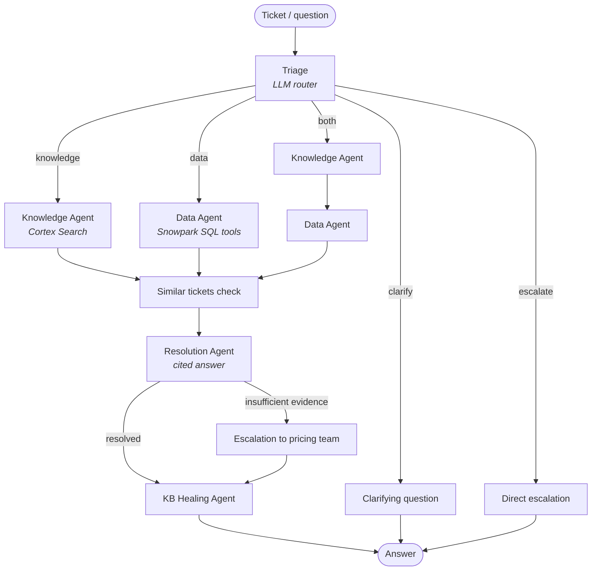

# 🚢 Maritime Hypercare Agents

**Multi-agent NLP support assistant for maritime pricing tools**, built with
**LangGraph** and **Snowflake Cortex** (LLM, Cortex Search, document AI).

Support teams receive a stream of tickets about pricing tools (here *AQUA*, the
internal pricing tool, and *SpotOn*, the online spot-sales channel): price
mismatches, missing offers, stuck bookings, rule questions… This project
automates the first line of support: it classifies each request, searches the
documentation, queries the operational data, writes an answer **with cited
sources**, escalates when the evidence is insufficient, and proposes knowledge
base updates when the same question keeps coming back.

> All operational data in `sql/01_seed_data.sql` is fictitious and only meant for demonstration.

---

## ✨ Features

| Agent | Role | Tech |
|---|---|---|
| **Triage** | Classifies the ticket (11 categories), extracts & normalises IDs (`booking 3` → `BK-003`), picks a route: *knowledge / data / both / clarify / escalate* | LLM structured output (Pydantic) |
| **Knowledge Agent** | Hybrid (vector + keyword) search over parsed PDFs, DOCX, PPTX, images and transcribed videos | Cortex Search, `AI_PARSE_DOCUMENT`, `AI_TRANSCRIBE` |
| **Data Agent** | Multi-round tool calling over quotes, bookings, price lines, routes, tickets | LangChain tools + Snowpark SQL (bind parameters) |
| **Resolution Agent** | Synthesises the evidence, cites `[DOC-xxx]` / `[DATA: TABLE]`, flags contradictions, never invents a reason | LLM |
| **Escalation** | Hands over to the pricing team with partial findings | — |
| **KB Healing Agent** | Detects recurring tickets and proposes documentation updates (human-validated) | LLM |

Plus: a **Streamlit chat UI**, a **FastAPI REST API**, and an **evaluation notebook**
(routing accuracy, category accuracy, citation rate, hallucination guard, latency).

## 🧠 Architecture



## 📁 Project structure

```
.
├── app/
│   ├── hypercare_agents.py   # LangGraph pipeline, tools, LLM & Snowflake config
│   ├── streamlit_app.py      # Chat UI (Streamlit in Snowflake or local)
│   ├── api.py                # REST API (FastAPI)
│   ├── snowflake.yml         # Snowflake CLI deployment definition
│   ├── pyproject.toml        # Dependencies for Streamlit in Snowflake
│   └── .streamlit/config.toml
├── sql/
│   ├── 00_setup.sql          # Warehouse, database, schema, document stage
│   ├── 01_seed_data.sql      # 6 tables + demo data
│   └── 02_kb_builder.sql     # Parse → chunk → Cortex Search service
├── notebooks/
│   ├── evaluation.ipynb      # 12-scenario evaluation suite + charts
│   ├── agents_playground.ipynb  # Tool & pipeline tests
│   ├── seed_data.ipynb       # Interactive version of 01_seed_data.sql
│   └── kb_builder.ipynb      # Interactive version of 02_kb_builder.sql
├── knowledge_docs/           # Put your documentation here (git-ignored)
├── .env.example              # Config template for local / API use
└── requirements.txt          # Local dependencies
```

---

## 🚀 Getting started

### Prerequisites

- A Snowflake account with **Cortex** enabled (Cortex Search, `AI_PARSE_DOCUMENT`,
  `AI_TRANSCRIBE` and access to an LLM through the Cortex AI Gateway — default
  model `openai-gpt-5.4`, configurable with `LLM_MODEL`)
- A role able to create a database/warehouse (e.g. `ACCOUNTADMIN`)
- Your documentation files (PDF, DOCX, PPTX, XLSX, PNG, MP4)

### 1. Set up Snowflake (once)

In a **Snowsight SQL worksheet**, run in order:

1. [`sql/00_setup.sql`](sql/00_setup.sql) — creates `COMPUTE_WH`, `HYPERCARE_DB.PUBLIC` and the `@DOCS` stage
2. Upload your documents to `@HYPERCARE_DB.PUBLIC.DOCS` (see [`knowledge_docs/README.md`](knowledge_docs/README.md))
3. [`sql/01_seed_data.sql`](sql/01_seed_data.sql) — creates and fills the 6 operational tables
4. [`sql/02_kb_builder.sql`](sql/02_kb_builder.sql) — parses the documents and creates the `KNOWLEDGE_BASE` Cortex Search service

> Want other names? Change them at the top of the SQL scripts, in `app/snowflake.yml`,
> and set `HYPERCARE_DATABASE` / `HYPERCARE_SCHEMA` / `HYPERCARE_SEARCH_SERVICE`.

### 2a. Run inside Snowflake (Streamlit in Snowflake)

**Option A — Snowsight Workspaces (no CLI):** *Projects → Workspaces → From Git repository*,
paste this repository URL, open `app/streamlit_app.py` and click **Run**.

**Option B — Snowflake CLI:**

```bash
pip install snowflake-cli
snow connection add            # configure your account once
cd app
snow streamlit deploy --replace --open
```

The app runs on the container runtime (`SYSTEM_COMPUTE_POOL_CPU`) and needs an
External Access Integration to install the PyPI packages listed in `app/pyproject.toml`.
Inside Snowflake no secret is needed: the app uses its own session and OAuth token.

### 2b. Run locally (Streamlit UI or REST API)

```bash
git clone https://github.com/<your-username>/maritime-hypercare-agents.git
cd maritime-hypercare-agents
python -m venv .venv
# Windows: .venv\Scripts\activate    |   macOS/Linux: source .venv/bin/activate
pip install -r requirements.txt
cp .env.example .env               # then fill in your Snowflake account, user and PAT
```

Create a **Programmatic Access Token** in Snowsight (*Settings → Authentication*) and
put it in `SNOWFLAKE_PAT`. It is used both for SQL (Snowpark) and for the Cortex LLM endpoint.
You can also use any OpenAI-compatible API for the LLM with `LLM_PROVIDER=openai` +
`OPENAI_API_KEY` (data and search still come from Snowflake).

**Chat UI**

```bash
streamlit run app/streamlit_app.py
```

**REST API**

```bash
uvicorn api:app --app-dir app --reload
# Swagger UI: http://localhost:8000/docs
```

```bash
curl -X POST http://localhost:8000/ask \
  -H "Content-Type: application/json" \
  -d '{"question": "Can you look up booking BK-001 and tell me its current status?"}'

curl -X POST http://localhost:8000/tickets/TK-007/process
```

| Endpoint | Description |
|---|---|
| `GET /health` | Liveness check |
| `POST /ask` | Run a free-form question through the pipeline (`question`, optional `quote_id`, `booking_id`, `route_id`) |
| `POST /tickets/{ticket_id}/process` | Process an existing ticket from the `TICKETS` table |

The response contains the answer, the triage category and route, the escalation flag,
the KB-healing proposal and the full agent trace.

### 3. Evaluate

Open [`notebooks/evaluation.ipynb`](notebooks/evaluation.ipynb) (in Snowflake Notebooks
or locally with your `.env`) and **Run All** (~3 min). It runs 12 scenarios and reports:
routing accuracy, category accuracy, citation rate, hallucination guard, escalation rate,
KB gaps detected and average latency, plus a visual dashboard.

## ⚙️ Configuration

| Variable | Default | Description |
|---|---|---|
| `HYPERCARE_DATABASE` / `HYPERCARE_SCHEMA` | `HYPERCARE_DB` / `PUBLIC` | Where the tables live |
| `HYPERCARE_SEARCH_SERVICE` | `KNOWLEDGE_BASE` | Cortex Search service name |
| `LLM_PROVIDER` | `snowflake` | `snowflake` (Cortex AI Gateway) or `openai` |
| `LLM_MODEL` | `openai-gpt-5.4` | Model name for the chosen provider |
| `LLM_BASE_URL` | Cortex AI Gateway URL | Override the OpenAI-compatible endpoint |
| `SNOWFLAKE_ACCOUNT`, `SNOWFLAKE_USER`, `SNOWFLAKE_PAT` | — | Local / API only |
| `SNOWFLAKE_CONNECTION_NAME` | — | Use an entry of `~/.snowflake/connections.toml` instead |

See [`.env.example`](.env.example) for the full list.

## 🛠️ Tech stack

Python 3.11 · LangGraph · LangChain · Pydantic · Snowflake Snowpark · Snowflake Cortex
(AI Gateway, Cortex Search, AI_PARSE_DOCUMENT, AI_TRANSCRIBE) · Streamlit · FastAPI
